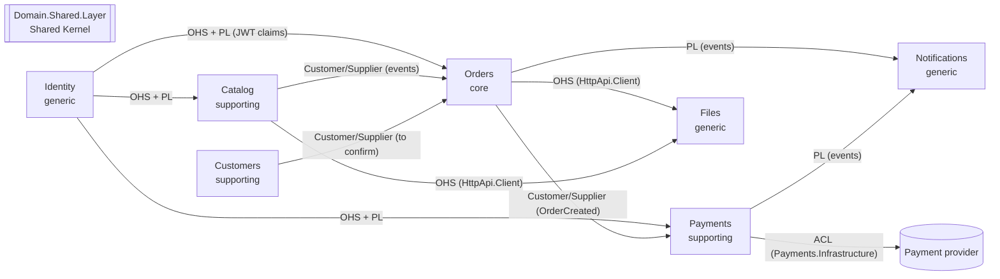

# Context map

Source: section 2.21 of `docker-learning-project-plan.pdf`. Refined after the event storming.

## Bounded contexts and subdomains

| Context | Subdomain | Why | Owns |
|---------|-----------|-----|------|
| Orders | Core | The heart of the business, where most modeling effort goes | Order and its lifecycle |
| Catalog | Supporting | Needed, but not the differentiator | Product, StockItem |
| Customers | Supporting | Needed by orders | Customer |
| Payments | Supporting | Simulated here, a provider in real life | Payment |
| Notifications | Generic | A commodity | Notification |
| Identity | Generic | ASP.NET Identity does the work | User, Role |
| Files | Generic | A commodity | FileRecord |

Each context owns its model and (from Phase 4) its database. Nothing is shared except the small
Domain.Shared.Layer kernel.

## Relationships

| Relationship | Pattern | How |
|--------------|---------|-----|
| Identity to every context | Open Host Service + Published Language | The JWT claims and the user id are the contract. Others conform. |
| Catalog to Orders | Customer / Supplier | Orders keeps its own small read model of products (name, price at order time), updated from Catalog events. No shared tables or entities. |
| Orders to Payments | Customer / Supplier | OrderCreated event. Payments answers with PaymentCompleted or PaymentFailed. |
| Orders and Payments to Notifications | Published Language | Notifications consumes the events and conforms to them. |
| Payments and the payment provider | Anti-Corruption Layer | An adapter in Payments.Infrastructure translates the provider's model into the Payments model. |
| Every context to Files | Open Host Service | Other contexts call the Files API through its HttpApi.Client and keep at most a file Guid. The file record keeps ModuleName, EntityName and EntityId. |
| All contexts and Domain.Shared.Layer | Shared Kernel | Kept very small: base types, contracts, constants. |

The Customers to Orders relationship is not described in the plan. It is shown as a question
(see [event-storming.md](event-storming.md)).

## How the contexts are deployed, phase by phase

| Phase | Deployment |
|-------|-----------|
| 1 to 3 | One modular monolith: one set of `OrderFlow.*` projects, the contexts are modules (folders). Phase 1 talks in-process; Phase 3 turns domain events into integration events through RabbitMQ, still before the split. |
| 4 onward | Six services in one solution, each with its own set of projects and its own database: Identity, Catalog, Orders, Payments, Notifications, Files. A YARP gateway is the only public entry point. |

Note from the phases plan: in Phase 4, Customers lives inside the Orders service, unless the event
storming says otherwise. This is an open question (see [event-storming.md](event-storming.md)).

## Rules

- Other aggregates and other contexts are referenced by id (Guid) only, never by object.
- Consistency between contexts is eventual, through events.
- No shared tables and no shared entities between contexts.
- The ubiquitous language of each context is in [glossary.md](glossary.md).
